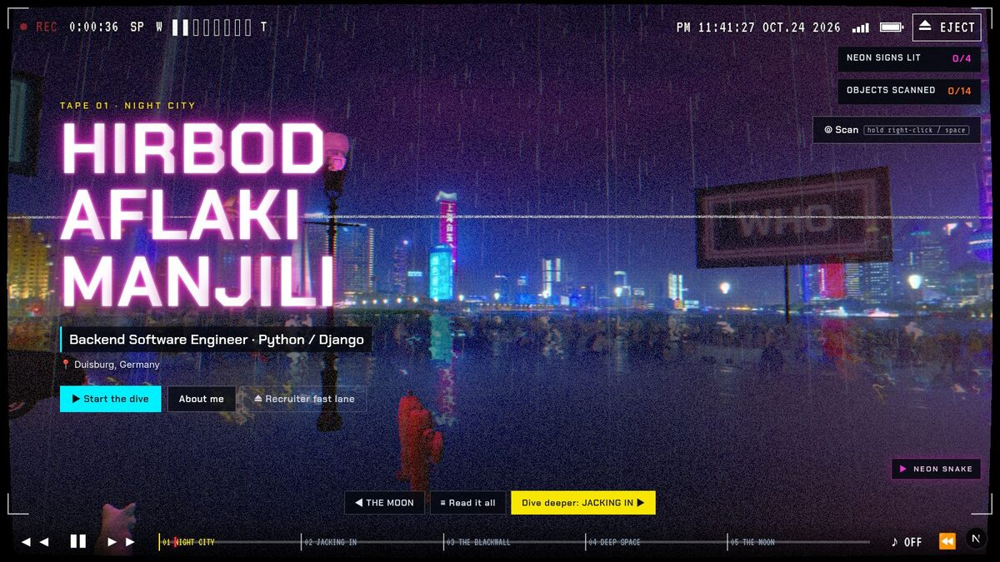

  

  <a href="mailto:hirbodprime@gmail.com">Email</a> &nbsp; / &nbsp;
  <a href="https://linkedin.com/in/hirbodprime">LinkedIn</a> &nbsp; / &nbsp;
  <a href="https://github.com/hirbodprime?tab=repositories">Explore my code</a>

<h3 align="center">🌐 <a href="https://hirbodaflaki.com">hirbodaflaki.com</a> — my portfolio is a game. Jack in.</h3>

  

  <b><a href="https://github.com/hirbodprime/the-dive">THE DIVE</a></b>: five explorable real-time 3D worlds instead of a scrolling page. 
  Night City → the Net → <b>a breach-protocol hack through the Blackwall</b> → Deep Space → the Moon. 
  <code>Next.js 16</code> <code>React Three Fiber</code> <code>hand-written GLSL</code> <code>WebGL</code> · <b>open source (MIT)</b>

## `01` / About me

I'm **Hirbod**, a Python and Django developer. I build web applications, backend APIs and automation tools — from e-commerce workflows to Telegram bots and data collection.

My main toolkit is **Python · Django · Django REST Framework · Redis · Celery · Linux**. I'm also exploring Docker, test-driven development and concurrency.

## `02` / Selected projects

> **Featured:** [The Dive](https://github.com/hirbodprime/the-dive), this portfolio's own source: custom shaders, a procedurally posed holographic character, a working hacking minigame and a 1 GB-VPS deploy pipeline.

<table>
<tr>
<td width="50%" valign="top">
<h3><a href="https://github.com/hirbodprime/flibbo">Flibbo AI</a></h3>

The complete backend of Flibbo, an AI content app on <a href="https://play.google.com/store/apps/details?id=com.flibbo.app">Google Play</a>: social feed, real-time chat, AI studio, crypto payments and push notifications.

<code>Django</code> <code>DRF</code> <code>AI APIs</code>

</td>
<td width="50%" valign="top">
<h3><a href="https://github.com/hirbodprime/flhub">FLHub</a></h3>

A multi-level marketing platform with crypto checkout, referral trees, multiple wallets, bonuses and withdrawals.

<code>Django</code> <code>Celery</code> <code>Plisio</code>

</td>
</tr>
<tr>
<td width="50%" valign="top">
<h3><a href="https://github.com/hirbodprime/blackjack">BlackJack Casino Bot</a></h3>

A Telegram casino with multiplayer blackjack, horse racing, quests, inventory and referrals, used by 200+ active players.

<code>Python</code> <code>Django</code> <code>Telegram</code>

</td>
<td width="50%" valign="top">
<h3><a href="https://github.com/hirbodprime/BigPapa">Big Papa Games</a></h3>

Papa Chop, an HTML5 game that runs as a Telegram Mini App. <a href="https://bigpapagames.com/play">Play it here</a>.

<code>Python</code> <code>Canvas</code> <code>Telegram Mini App</code>

</td>
</tr>
</table>

## `03` / Let's connect

Interested in Python, Django or backend development? Reach me at **[hirbodprime@gmail.com](mailto:hirbodprime@gmail.com)** or connect on **[LinkedIn](https://linkedin.com/in/hirbodprime)**.

Build something useful. Understand how it works. Keep improving it.

